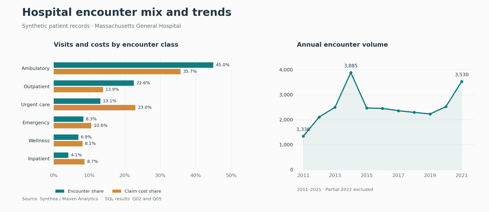

# Hospital Operations Analysis with SQL

**Rohit Chauhan · MySQL**

This project examines patient visits, procedure demand, claim costs, and return visits using synthetic hospital records. The aim is to identify where activity and costs are concentrated and which findings deserve a closer operational review.

The analysis covers **974 patients and 27,891 encounters from 2 January 2011 to 5 February 2022**. It includes 12 core questions and four extensions using window functions.

## Findings

- Ambulatory encounters account for **44.95% of visits** and **35.74% of claim costs**, making them the largest activity group.
- Urgent care accounts for **13.14% of visits** and **23.00% of claim costs**. Its average claim is **$6,369.16**, which makes procedure mix a useful next area to investigate.
- **48.71% of encounters have zero payer coverage**. Across the extract, payer coverage totals **$31.10 million** against **$101.51 million** in claims. Coverage patterns warrant review at payer level.
- After combining overlapping inpatient records, **350 of 886 eligible discharges had an observed inpatient return within 30 days (39.50%)**. Those returns involve 22 patients. The eligibility rules and scope are documented in the analysis notes.

The calculations behind these findings are Q05, Q06, Q09, and A04. Saved query outputs are available in [results](results/).

## Data

| Table | Rows | One row represents |
| --- | ---: | --- |
| patients | 974 | A synthetic patient |
| encounters | 27,891 | A recorded visit |
| procedures | 47,701 | A procedure record |
| payers | 10 | An insurance payer or the no-insurance category |
| organizations | 1 | A hospital |

## Run the project

Use **MySQL Server 8.0.16+** with MySQL Workbench. The scripts were tested on **MySQL 8.4.13**.

1. Open a connection in Workbench and enable **Stop Script Execution On Errors**.
2. Open and execute [01_create_tables.sql](sql/01_create_tables.sql).
3. Execute [02_insert_data.sql](sql/02_insert_data.sql). It contains all data and replaces the five project tables' contents on rerun.
4. Run [03_data_checks.sql](sql/03_data_checks.sql). D01 counts should match and D02 issue counts should be zero.
5. Run [04_analysis.sql](sql/04_analysis.sql), then [05_advanced_analysis.sql](sql/05_advanced_analysis.sql).

Execute each complete file. If the data import fails, run `ROLLBACK;` in the same connection before retrying. CSV import and local path changes are unnecessary because the insert script includes the supplied data.

## Approach

The SQL demonstrates joins, aggregations, `CASE`, CTEs, `LAG`, `LEAD`, `DENSE_RANK`, rolling averages, and reusable views. Procedure records are aggregated before joining to encounter totals to prevent double-counting.

2022 contains a partial year. The source also contains inconsistent procedure timings and costs. Claims, payer coverage, and procedure base costs are therefore analysed as distinct measures. Definitions, quality observations, and the table relationships are in [analysis notes](docs/analysis_notes.md).

## Source

The dataset is published by Maven Analytics, generated with Synthea, and listed as public domain. The original CSVs, data dictionary, and research citation are included in `data/`. [Hospital Patient Records dataset](https://mavenanalytics.io/data-playground/hospital-patient-records) · [Synthea research paper](https://doi.org/10.1093/jamia/ocx079)
