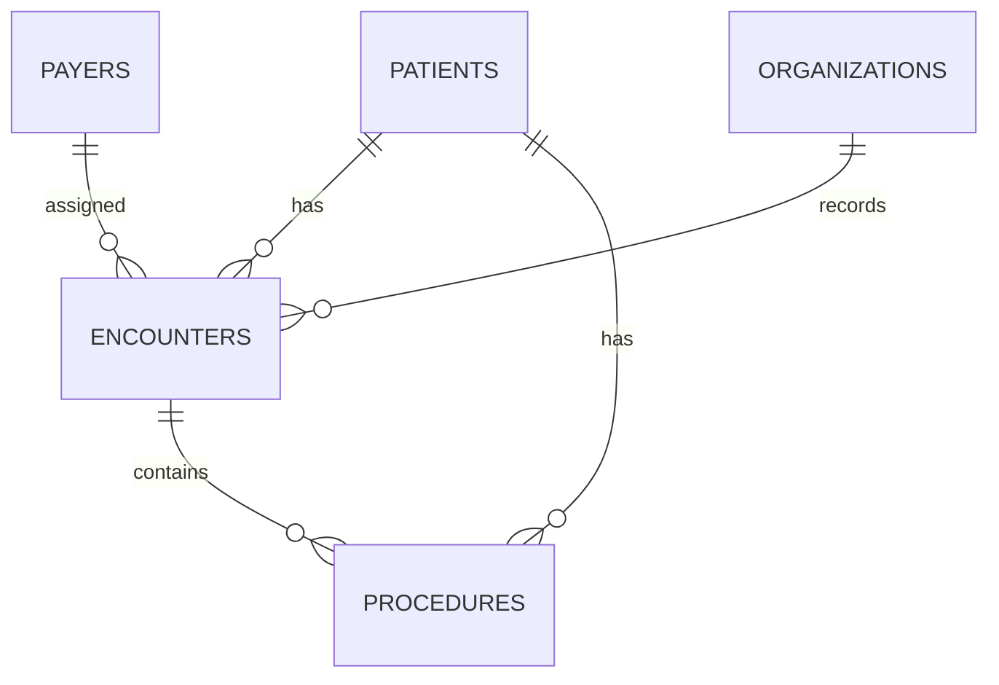

# Analysis notes

## Scope and preparation

The supplied extract contains synthetic records associated with Massachusetts General Hospital. Conclusions describe this sample. It contains one organization, and the available encounters run from 2 January 2011 to 5 February 2022.

All five source CSVs are included. The loading script converts blank values to SQL `NULL` and ISO timestamps to UTC `DATETIME` values. Currency uses `DECIMAL(12,2)`. Postal codes and clinical codes remain text. A procedure ID records its original CSV data-row number because the source has no procedure identifier.

The supplied setup was extended to include `organizations`, foreign keys, and indexes. The source dictionary also lists Middle and FIPS County Code fields that are absent from this patients CSV. The schema follows the supplied CSV columns.

## Metric definitions

| Measure | Calculation and scope |
| --- | --- |
| Encounter count | Count of rows in `encounters` |
| Patients seen | Distinct patient IDs within the selected period |
| Average claim | Total encounter claim cost divided by encounter count |
| Payer coverage percentage | Sum of payer coverage divided by sum of total claim cost |
| Encounter duration | Elapsed seconds between start and stop, converted to hours |
| Procedure frequency | Count of procedure records grouped by code |
| Age group | Completed years between birth date and encounter start |
| Claim amount without payer coverage | Total claim cost minus payer coverage. This extract does not establish how that remainder was settled. |

Procedure base costs are already part of the encounter's claim definition. Adding the two cost fields would double-count services. Q12 first groups procedures by encounter, then joins those counts to encounters. Procedure descriptions are represented by the alphabetically first description for each code.

Q04 has separate groups for under, exactly, and over 24 hours. Quarter-level patient counts can include the same person in several quarters. Q11 returns the three age groups present in the data.

Annual and quarterly tables label the partial 2022 periods. Monthly trends exclude February 2022. D05 verifies that every month is present before `LAG` and the rolling average are applied. The first two months have an empty three-month average.

## Repeat visits and inpatient returns

**A03 counts repeat visits across all encounter classes.** Each visit is compared with the immediately preceding visit for that patient, ordered by start time and encounter ID. A repeat starts more than zero and at most 30 days after that preceding visit ends. Planned appointments can qualify. The result is 16,552 repeat visits involving 770 patients.

**A04 measures observed inpatient returns.** The 1,135 inpatient records combine into 934 stays when overlapping or touching intervals are merged for the same patient. A running maximum of previous stop times handles nested overlaps correctly.

An eligible discharge has a full 30-day window before the latest encounter stop in the extract and a death date that is blank or later than the end of that window. This leaves 886 eligible discharges. A return occurs when the next merged inpatient stay starts after discharge and within 30 days, including the exact 30-day boundary.

There are 350 eligible discharges with a return, involving 22 patients, for an observed return percentage of 39.50%. Each eligible discharge contributes once to the denominator. A patient can contribute several discharges. The calculation includes planned and unplanned returns and only captures records in this extract. The survival requirement is a project-specific cohort choice, so the percentage should be interpreted within this definition. Clinical quality benchmarking would require further admission, transfer, and risk-adjustment information.

## Data quality observations

D02 returned zero issues for its 12 relationship, date, cost, and duplicate checks. The following source observations are retained and reported by D03.

| Observation | Count | Treatment |
| --- | ---: | --- |
| Procedure intervals outside linked encounter times | 28,849 procedure records | Keep source values. Use encounter timestamps for encounter durations. |
| Procedure base-cost sum above the linked claim | 5,086 encounters | Report each cost measure at its own level. |
| Encounter starts after recorded patient death date | 53 encounters | Retain in source activity totals. The inpatient follow-up cohort excludes stays without survival through follow-up. |
| Zero claim cost | 89 encounters | Retain and distinguish in the coverage analysis. |
| Missing encounter reason code | 19,541 encounters | Keep as `NULL`. |
| Missing patient ZIP code | 142 patients | Keep as `NULL`. |

These observations limit detailed service-cost reconciliation and clinical interpretation. The next operational review would examine urgent-care procedure mix, payer coverage patterns, and the reasons behind frequent inpatient returns.

## Table relationships

## Verification and outputs

All five scripts ran on MySQL Community Server 8.4.13. Every imported field was compared with the supplied CSVs after the stated conversions. The import was run twice and produced the same counts and claim total. Key results, monthly trends, and the inpatient interval calculation were independently checked against the CSVs.

The `results/` files are direct SQL exports. Their IDs match the comments in the scripts. Blank output cells represent SQL `NULL`. `assets/hospital_findings.png` is a static chart of Q02 and Q05, with 2022 omitted from the annual comparison. Refresh the exports and chart after changing data or query definitions.
